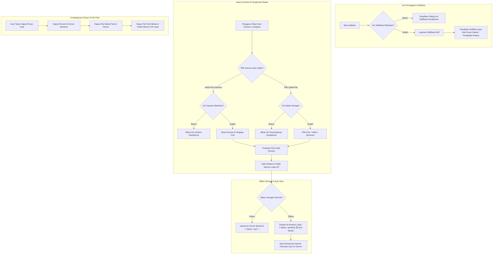

# 📲 Offline Storage, Handphone Permissions (Notifikasi, Kamera & Storage), Media Chat & Auto-Sync Implementation Plan

> **For Claude:** REQUIRED SUB-SKILL: Use superpowers:executing-plans to implement this plan task-by-task.

**Goal:** Menambahkan izin handphone lengkap (Notifikasi, Kamera langsung, dan Penyimpanan lokal), arsitektur *offline-first* dengan sinkronisasi otomatis saat online, pengiriman media (Foto dari Kamera/Galeri, Video, Dokumen) pada chat yang tersimpan di folder memori lokal perangkat, penghapusan file fisik lokal saat pesan dihapus, serta migrasi skema database MySQL.

**Architecture:**
- **Izin & Notifikasi**:
  - Penambahan deklarasi izin di `AndroidManifest.xml`:
    - `android.permission.POST_NOTIFICATIONS` (Notifikasi pesan masuk & reminder)
    - `android.permission.CAMERA` (Akses kamera langsung untuk mengambil foto dari dalam chat)
    - `android.permission.READ_MEDIA_IMAGES`, `android.permission.READ_MEDIA_VIDEO` (Android 13+)
    - `android.permission.READ_EXTERNAL_STORAGE`, `android.permission.WRITE_EXTERNAL_STORAGE` (Android <= 12)
  - Modul `PermissionService` untuk pengecekan & permintaan izin runtime (Kamera, Media, Notifikasi) secara elegan.
  - Modul `NotificationService` (`flutter_local_notifications`) untuk menampilkan banner notifikasi pesan masuk saat aplikasi di background atau tab lain.
- **Pengambilan Foto Langsung dari Kamera**:
  - Integrasi `image_picker` dengan `ImageSource.camera` dan fallback ke `ImageSource.gallery`.
  - Preview foto hasil jepretan kamera sebelum dikirim dengan tombol Kirim dan Ulangi.
- **Offline-First & Local Storage**:
  - Modul `LocalStorageService` untuk menyimpan file media ke folder terstruktur (`DompetLinc/Media/Images`, `Videos`, `Documents`).
  - Modul `OfflineSyncService` untuk mengantrekan (*queue*) pesan & transaksi saat offline dan menyinkronkannya saat kembali online.
- **Media Chat (Foto Kamera/Galeri, Video, Dokumen)**:
  - Backend upload multipart via `multer` yang disimpan di `backend/uploads/chat/`, disajikan via Express static route, dan didukung penghapusan file fisik baik di server maupun di memori perangkat saat pesan dihapus.
- **Database MySQL Migration**:
  - Update enum `message_type` di tabel `chat_messages` (`image`, `video`, `file`), auto-migration di `database.js`, dan sinkronisasi `schema.sql`.

**Tech Stack:**
- **Backend**: Node.js (ES Modules), Express.js, Multer (multipart upload), MySQL / MockDatabase, fs/promises (file deletion).
- **Frontend**: Flutter 3.x, Dart, `permission_handler`, `flutter_local_notifications`, `image_picker`, `file_picker`, `path_provider`, `open_filex`, `shared_preferences`.

---

## 1. Alur Kerja & Interaksi Pengguna (Workflow & UX)



---

## 2. Desain Database & Skema Migrasi MySQL

### Pembaruan Tabel `chat_messages`
```sql
ALTER TABLE chat_messages MODIFY COLUMN message_type ENUM('text', 'system', 'financial_share', 'image', 'video', 'file') DEFAULT 'text';
```

Struktur payload `metadata` untuk pesan media (Foto Kamera, Galeri, Video, File):
```json
{
  "file_url": "/uploads/chat/1732289000_photo.jpg",
  "file_name": "foto_nota_kamera.jpg",
  "file_size": 245080,
  "mime_type": "image/jpeg",
  "local_path": "/storage/emulated/0/Download/DompetLinc/Media/Images/foto_nota_kamera.jpg",
  "source": "camera",
  "thumbnail_url": null,
  "duration_seconds": null
}
```

Endpoint Penghapusan Pesan:
- `DELETE /api/v1/chat/messages/:id`: Menghapus data pesan dari MySQL dan sekaligus menghapus berkas fisik di direktori `backend/uploads/chat/`.

---

## 3. Rincian Rencana Kerja Bertahap (Bite-Sized Tasks)

### Task 1: Migrasi Database MySQL & Backend Media Upload/Delete
- **Berkas yang dimodifikasi / dibuat:**
  - `backend/package.json`: Tambahkan dependensi `multer`.
  - `backend/src/config/database.js`:
    - Jalankan auto-migration: `ALTER TABLE chat_messages MODIFY COLUMN message_type ENUM('text', 'system', 'financial_share', 'image', 'video', 'file') DEFAULT 'text';`.
  - `backend/database/schema.sql`: Perbarui definisi `chat_messages`.
  - `backend/src/services/chat.service.js`:
    - Tambahkan method `deleteMessage(messageId, userId)` yang memvalidasi kepemilikan pesan dan menghapus berkas fisik jika ada file media.
  - `backend/src/app.js`:
    - Konfigurasi `multer` storage di `backend/uploads/chat/`.
    - Static file serving: `app.use('/uploads', express.static(path.join(__dirname, '../uploads')));`.
    - Endpoint `POST /api/v1/chat/upload` (single file multipart).
    - Endpoint `DELETE /api/v1/chat/messages/:id`.
  - `backend/tests/chat.test.js`:
    - Unit test untuk upload media metadata, pengiriman pesan foto/video/file, dan penghapusan pesan.
- **Verifikasi:** Jalankan `node --test backend/tests/*.test.js` (100% lolos).

---

### Task 2: Android Permissions (Kamera, Notifikasi, Storage) & Notification Setup
- **Berkas yang dimodifikasi / dibuat:**
  - `frontend/pubspec.yaml`:
    - Tambahkan `permission_handler: ^11.3.1`
    - Tambahkan `flutter_local_notifications: ^17.2.1`
    - Tambahkan `image_picker: ^1.1.2`
    - Tambahkan `file_picker: ^8.0.0`
    - Tambahkan `path_provider: ^2.1.3`
    - Tambahkan `open_filex: ^4.4.0`
  - `frontend/android/app/src/main/AndroidManifest.xml`:
    - Tambahkan izin `android.permission.CAMERA`
    - Tambahkan fitur kamera: `<uses-feature android:name="android.hardware.camera" android:required="false" />`
    - Tambahkan izin `android.permission.POST_NOTIFICATIONS`, `VIBRATE`.
    - Tambahkan izin `READ_EXTERNAL_STORAGE`, `WRITE_EXTERNAL_STORAGE` (`android:maxSdkVersion="32"`).
    - Tambahkan izin `READ_MEDIA_IMAGES`, `READ_MEDIA_VIDEO`.
  - `frontend/lib/services/permission_service.dart`:
    - Fungsi `requestCameraPermission()`: Memeriksa dan meminta izin kamera handphone. Jika ditolak secara permanen, arahkan user ke settings.
    - Fungsi `requestNotificationPermission()`
    - Fungsi `requestMediaPermissions()`
  - `frontend/lib/services/notification_service.dart`:
    - Inisialisasi Android Notification Channel (`high_importance_channel`).
    - Fungsi `showChatNotification({required String title, required String body, int id})`.

---

### Task 3: Local Storage Service & Offline Caching Queue
- **Berkas yang dibuat:**
  - `frontend/lib/services/local_storage_service.dart`:
    - Menyiapkan struktur direktori di penyimpanan perangkat:
      - `DompetLinc/Media/Images` (termasuk foto dari kamera)
      - `DompetLinc/Media/Videos`
      - `DompetLinc/Media/Documents`
    - Fungsi `saveMediaToLocalStorage(File sourceFile, String mediaType)`: menyalin file ke folder perangkat lokal.
    - Fungsi `deleteLocalMedia(String localPath)`: menghapus berkas fisik dari memori handphone saat pesan dihapus.
  - `frontend/lib/services/offline_sync_service.dart`:
    - Menyimpan antrean offline (*offline queue*) di `SharedPreferences` / JSON cache:
      - Pesan yang dikirim saat offline berstatus `pending` (Jam Merah ⏱️).
      - Catatan transaksi keuangan yang diinput saat offline.
    - Mekanisme auto-sync: ketika koneksi internet terdeteksi aktif kembali, otomatis mengirimkan antrean ke backend dan memperbarui status menjadi `sent` (Centang 1 ✓).

---

### Task 4: UI Media Chat (Kamera Langsung, Galeri, Video, Dokumen) & Menu Aksi Hapus
- **Berkas yang dimodifikasi / dibuat:**
  - `frontend/lib/screens/chat/widgets/media_attachment_sheet.dart`:
    - Bottom sheet interaktif dengan 4 opsi pilihan:
      1. 📷 **Kamera**: Buka kamera HP langsung untuk memotret nota/struk/gambar.
      2. 🖼️ **Galeri Foto**: Pilih gambar dari galeri perangkat.
      3. 🎥 **Video**: Pilih video dari memori HP.
      4. 📄 **Dokumen / File**: Pilih file PDF, Excel, Word, atau arsip.
  - `frontend/lib/screens/chat/chat_room_screen.dart`:
    - Tambahkan tombol pintasan kamera langsung (`Icons.camera_alt_rounded`) di sebelah textfield input chat untuk akses cepat jepret foto kamera 1-klik.
    - Dialog preview foto hasil kamera sebelum dikirim.
  - `frontend/lib/screens/chat/widgets/chat_bubble.dart`:
    - Menampilkan preview foto dengan border radius halus iOS 18.
    - Menampilkan kartu player thumbnail untuk video dengan tombol play.
    - Menampilkan kartu file untuk dokumen dengan nama file, ukuran (KB/MB), icon tipe file, dan tombol "Buka File" (`open_filex`).
  - Fitur **Hapus Pesan & Hapus File Lokal**:
    - Long-press pada bubble chat memunculkan dialog konfirmasi:
      *"Hapus pesan ini dan hapus file terkait dari memori perangkat?"*
    - Jika dikonfirmasi: memanggil `chatProvider.deleteMessage(messageId, localPath)`.
  - `frontend/lib/providers/chat_provider.dart`:
    - Tambahkan fungsi `sendMediaMessage(int roomId, File file, String mediaType, ...)` dengan penanganan offline queue.
    - Tambahkan fungsi `deleteMessage(int roomId, int messageId, String? localPath)`.

---

### Task 5: Verifikasi Menyeluruh, Analisis Kode, & Rilis APK
1. Jalankan migrasi MySQL lokal (`ALTER TABLE chat_messages MODIFY COLUMN ...`).
2. Jalankan seluruh backend unit & integration tests (`node --test backend/tests/*.test.js`).
3. Jalankan static analysis Flutter: `flutter analyze` (target: 0 errors).
4. Kompilasi APK rilis Android: `flutter build apk --release`.
5. Git commit dan push seluruh perubahan ke remote repository GitHub (`master` & `main`).

---

## 4. Keputusan Desain & Pertanyaan Konfirmasi

1. **Pintasan Cepat Kamera Langsung**:
   - Di samping tombol lampiran plus `(+)`, disediakan ikon kamera langsung `📷` pada baris input chat agar pengguna dapat memotret nota/struk pengeluaran hanya dengan 1 sentuhan.
2. **Struktur Folder Memori Handphone**:
   - Disimpan di direktori dokumen terstruktur aplikasi (`DompetLinc/Media/Images`, `Videos`, `Documents`) agar aman dan patuh standar Scoped Storage Android 13+.
3. **Penghapusan Pesan & File Fisik**:
   - Menghapus pesan di chat akan menghapus data di database MySQL serta langsung menghapus berkas fisiknya dari memori HP.
